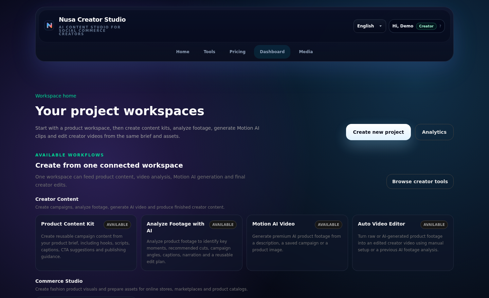
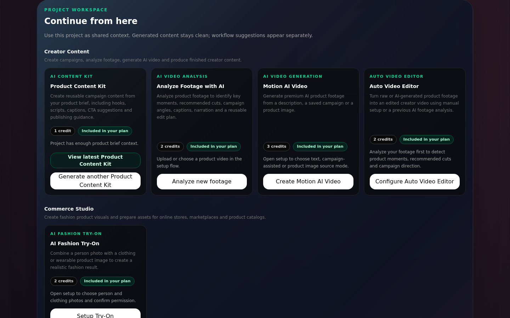
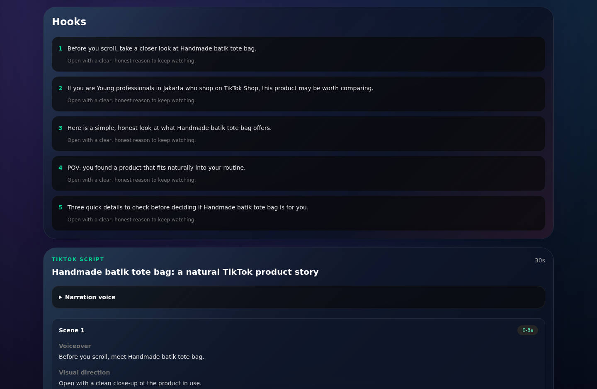
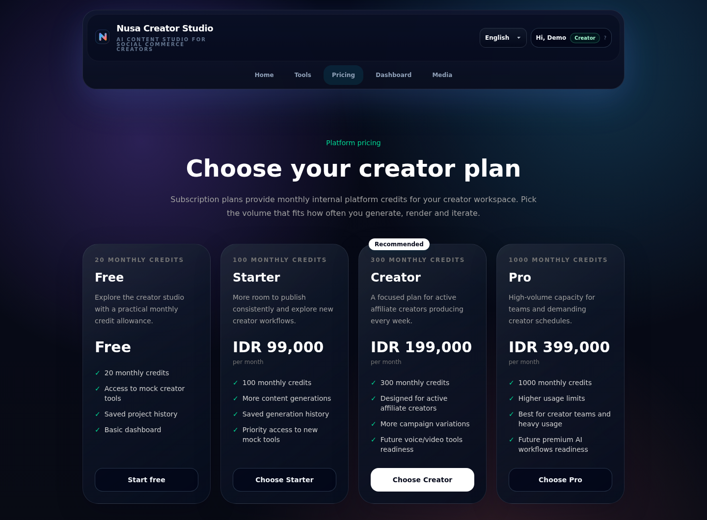
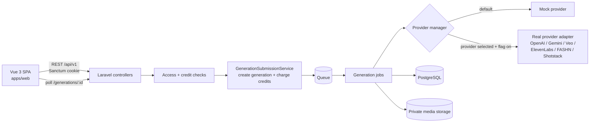

# Nusa Creator Studio

An open-source AI content studio for social-commerce sellers and creators, focused on Indonesia and Southeast Asia.

Nusa Creator Studio turns a product brief, product photos or raw footage into ready-to-use marketing content: campaign angles, hooks, scripts, captions, voiceovers, virtual try-on images and short videos. Everything lives in one project workspace with a shared media library and a full generation history.

> **Status:** open source and actively developed; the core flow is complete. It started as a SaaS prototype and has never been deployed to production or used by real customers. See [ROADMAP.md](ROADMAP.md) for what comes next.

| Dashboard | Project workspace actions |
| --- | --- |
|  |  |
| **Product Content Kit result** | **Plans and credits** |
|  |  |

_Screenshots taken locally in mock mode with the fictional demo account; the generated text is deterministic mock output, not a real AI response._

## Who it is for

- TikTok Shop and Shopee sellers who need a steady stream of product content.
- Affiliate creators who promote other people's products.
- Developers who want a self-hostable, provider-agnostic base for AI content workflows.

## Features

Verified in the current codebase:

- **Accounts and access**: registration, login and profile/password management with cookie-based Laravel Sanctum auth. Roles (`admin`, `internal_creator`, `subscriber`, `free_user`) and plans (Free, Starter, Creator, Pro) with prices in Indonesian Rupiah.
- **Credits**: every generation charges platform credits inside a database transaction, idempotently, and failed generations are refunded automatically. Every movement is recorded as a credit transaction.
- **Project workspace**: each project groups its assets, available actions and generation history. Actions are unlocked by plan tier (basic, advanced, premium).
- **Media library**: private uploads (images, video, audio) streamed and downloaded through authenticated routes, never through raw provider URLs.
- **Asynchronous generations**: every tool runs as a queued job; the frontend polls the generation until it completes or fails.
- **Creator tools**:

  | Tool | What it produces | Real provider (optional) |
  | --- | --- | --- |
  | Product Content Kit (affiliate campaign) | Campaign angle, hooks, script, scene breakdown, captions, hashtags, CTA | OpenAI |
  | Video to Campaign | Campaign built from an analysis of uploaded product footage | Google Gemini |
  | AI Voiceover | Narration audio from a script | ElevenLabs |
  | Fashion Try-On | Garment try-on images, with variations and a selectable favourite | FASHN |
  | Motion AI Video | Short product video from a prompt or a saved campaign | Google Veo |
  | Auto Video Editor | Edited vertical video from raw clips, with captions | Shotstack |
  | Video Enhancer, Product-to-Video Script | Caption pack and video script plans | Mock only for now |

- **Mock mode by default**: every tool has a deterministic mock provider, so the whole app runs without any API key. Real providers are switched on per tool with environment flags and can be limited to internal users.
- **Admin panel**: users and their access, creator tools (status, tier, credit cost) and plans.
- **Internationalisation**: English, Bahasa Indonesia and Spanish UI (translations in progress, see the roadmap).

## Tech stack

| Layer | Technologies |
| --- | --- |
| Frontend (`apps/web`) | Vue 3, TypeScript, Vite, Pinia, Vue Router, vue-i18n, Tailwind CSS 4, Vitest |
| Backend (`apps/api`) | PHP 8.4+, Laravel 13, Laravel Sanctum, PHPUnit, Pint |
| Data and services | PostgreSQL 16, database or Redis queue, Mailpit; MinIO (S3-compatible) optional |
| AI providers | OpenAI, Google Gemini, Google Veo, ElevenLabs, FASHN, Shotstack, all behind provider interfaces |

## Architecture



How a generation flows:

1. The user creates a project and uploads assets to the media library.
2. `POST /api/v1/projects/{id}/generate-*` checks the user's plan tier and credit balance.
3. `GenerationSubmissionService` creates a `queued` generation and charges credits in the same database transaction, then dispatches a job.
4. The job's processor asks the tool's **provider manager** which provider to use. It picks the real adapter only when that tool's `*_PROVIDER` points to it and `*_REAL_ENABLED` is on, and, if `*_REAL_INTERNAL_ONLY` is set, only for admin/internal users; otherwise it uses the mock.
5. The normalised result is saved on the generation and generated media is stored privately. On failure, `GenerationFailureService` marks the generation as failed and refunds the credits.
6. The frontend polls `GET /api/v1/generations/{id}` and renders the result with a tool-specific component.

Repository layout:

```text
apps/api     Laravel API (contracts, providers, jobs, services, tests)
apps/web     Vue 3 single-page app
docs/        Product and provider research notes
tools/       Optional Node bridge for Google Veo image-to-video
```

## Requirements

- Docker with Docker Compose (PostgreSQL, Redis, Mailpit)
- PHP 8.4.27+ or 8.5.12+ (the October 2026 security releases) with the `pdo_pgsql` extension, and Composer
- Node.js 22.18+ or 24.12+, and npm
- `make` (optional; every step can also be run by hand)

## Getting started

```bash
git clone https://github.com/AlvaroMillanEstevez/nusa-creator-studio.git
cd nusa-creator-studio
make setup   # start services, install dependencies, migrate and seed
make dev     # API on :8000, queue worker, web app on :5173
```

Open <http://localhost:5173> and sign in with one of the local demo accounts (password `password`):

| Email | Access |
| --- | --- |
| `demo@example.test` | Creator plan, 300 credits |
| `admin@example.test` | Admin, unlimited internal access |

These accounts are fictional and only seeded in the `local` and `testing` environments.

<details>
<summary>Manual setup without make</summary>

```bash
docker compose up -d postgres redis mailpit

cd apps/api
composer install
cp .env.example .env
php artisan key:generate
php artisan migrate --seed
php artisan serve            # terminal 1
php artisan queue:work       # terminal 2

cd ../web
npm ci
cp .env.example .env.local
npm run dev                  # terminal 3
```

</details>

## Configuration

All configuration is done through environment variables. See the commented examples:

- [`apps/api/.env.example`](apps/api/.env.example): database, queue, storage and every AI provider.
- [`apps/web/.env.example`](apps/web/.env.example): the API base URL. `VITE_*` variables end up in the public bundle, so never put secrets there.

To use a real provider, set its API key and flags in `apps/api/.env`, for example:

```dotenv
VOICEOVER_PROVIDER=elevenlabs
VOICEOVER_REAL_ENABLED=true
VOICEOVER_REAL_INTERNAL_ONLY=true   # only admin/internal users
ELEVENLABS_API_KEY=your-key-here
```

Some providers need to download your uploaded media. For local testing, expose the API through an HTTPS tunnel and set `PROVIDER_ASSET_PUBLIC_BASE_URL`.

## Running tests and linters

```bash
make test    # PHPUnit (SQLite in memory) + Vitest
make lint    # Pint, vue-tsc, ESLint and oxlint in check mode
```

The suites currently contain 360 backend tests and 232 frontend tests. Provider adapters are tested against faked HTTP responses, so the suites need no API keys.

## Adding a new AI provider

Every tool follows the same pattern, so a new provider is an adapter plus configuration. Using AI Voiceover as the example:

1. **Contract**: the tool's interface lives in `apps/api/app/Contracts` (for example `AiVoiceoverProvider`).
2. **Adapter**: create a class in `apps/api/app/Services/Generation` that implements the contract and maps the normalised input to the provider's API and back (see `ElevenLabsAiVoiceoverProvider`). Keep provider-specific payloads inside the adapter and return the same normalised result shape as the mock.
3. **Configuration**: add the provider's settings to the tool's config file (`apps/api/config/voiceover.php`), reading from environment variables, and document them in `.env.example` with empty values.
4. **Selection**: teach the tool's provider manager (`AiVoiceoverProviderManager`) when to choose the new adapter, keeping the mock as the default when the flag is off or the key is missing.
5. **Tests**: add feature tests with `Http::fake()` for success, provider errors and timeouts, and check that failures refund credits and that no secret or raw provider response leaks to the user.

Managers are bound to their contracts in `apps/api/app/Providers/AppServiceProvider.php`.

## How AI was used

This project was built with an AI coding agent, and I want to be clear about the split:

- **My part:** the product idea and who it is for, the scope of each creator tool, the research and choice of AI providers (the notes in [docs/research](docs/research) contain my findings, structured into documents with AI help), the mock-first rollout behind feature flags, the plans, credits and refund rules, and the UX and feature decisions across the app. I reviewed and analysed every change, tested each workflow by hand, including real-provider runs during internal testing, and decided what to keep, change or send back. My own manual code edits were minimal.
- **The AI's part:** almost all of the code and the tests were written by **OpenAI Codex** from my specifications. The logo was designed with **ChatGPT**. The open-source preparation (audit, environment examples, setup script, this README and the roadmap) was drafted with **Claude Code** and reviewed by me before each commit.
- **Validation:** the backend and frontend test suites, type checking and linters, followed by my own manual testing of each workflow in the browser.

## License

[MIT](LICENSE) © 2026 Alvaro Millan Estevez
